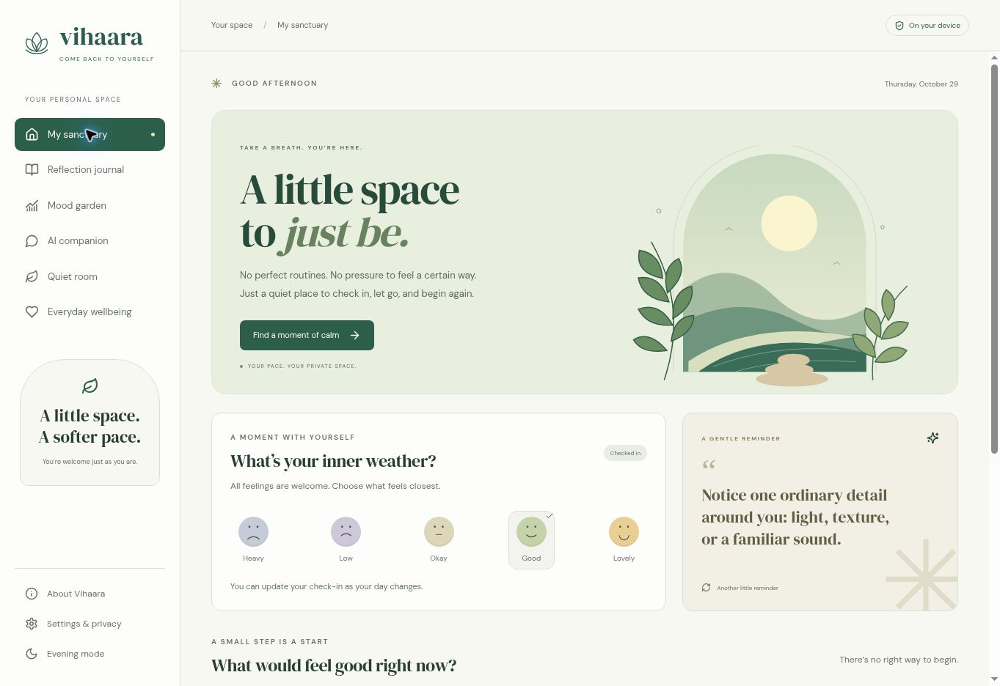

<div align="center">


# Vihaara
### A little space to just be.

A local-first mental wellness companion for reflection, mood awareness, and everyday calm.

**No account · No API key · No paid AI endpoint**

</div>



## A sanctuary, not another task list

Vihaara keeps its original purpose: a welcoming place to journal, check in with your feelings, talk through a thought, and explore wellbeing practices. Its botanical interface combines warm paper tones, an illustrated garden, gentle interactions, and an evening theme—without streaks or pressure to perform.

### What you can do

- **Check in with your inner weather:** save or update today's mood from the sanctuary, add context in Mood Garden, and see your actual recent check-ins.
- **Leave it on the page:** use journal prompts, save entries, expand the full text, and read local reflections.
- **Talk it through:** use the prepared offline guide immediately or explicitly load an on-device language model for generative chat and journal reflections.
- **Enter the quiet room:** try 1-, 3-, or 5-minute breathing sessions, a skippable five-senses grounding trail, and adjustable rain, shoreline, or low-breeze sounds generated with Web Audio.
- **Keep control of your records:** export or clear wellness data, remove downloaded model files, and recover raw records if a saved record is unreadable.
- **Take it offline:** the production service worker caches the app shell, fonts, icons, and code after a successful first load. Model files have their own optional cache.

## Honest AI modes

| Mode | How it works | Requirements |
| --- | --- | --- |
| Offline guide | Prepared prompts with local keyword matching; explicitly labelled as a guide, not generative AI | No download beyond the app |
| On-device AI | `SmolLM2-360M-Instruct-q4f32_1-MLC` through WebLLM in a Web Worker | HTTPS or localhost, WebGPU, several hundred MB of initial downloads and sufficient device memory |
| Mood summaries | Deterministic counts from the latest seven recorded check-ins | Your own saved records |
| Wellbeing library | Bundled general self-care material | No AI model needed |

Enable the model from Chat, Journal, or Settings. Loading has progress and cancellation controls. Unsupported browsers, load errors, or generation failure retain the offline guide. Generation has a timeout. The model is intentionally small and can produce weak, incorrect, or inappropriate responses; it has not been clinically evaluated. Some risk-related language bypasses generation for prepared support guidance, but this is **not reliable crisis detection**.

The first model download contacts Hugging Face and the WebLLM model library host. Personal journal/chat content is not sent to those hosts. After cached files are available, inference runs locally; browser cache eviction can require another download. No inference fees are charged by this code; device resources, connectivity and hosting are separate considerations.

## Run locally

Requires Node.js 20.11+ and npm. No `.env`, database, account, or provider credentials are needed.

```bash
npm ci
npm run dev
```

Open `http://localhost:5000`. You can set `PORT` or pass `--port` to the development command. Scripts work across Windows and POSIX shells.

```bash
npm run check       # TypeScript
npm run build       # production frontend, offline shell, and optional Express server
npm test            # local logic, data recovery, server and offline-cache tests
npm start           # production Express hosting
```

For a frontend-only deployment:

```bash
npm run build:static
```

Publish **`dist/public`** with SPA fallback to `index.html` and HTTPS. `vercel.json` configures this for Vercel; `render.yaml` describes a Render static site. Existing Render Node services can continue using `npm run build` / `npm start`, without AI keys. The repository configuration does not automatically migrate an existing hosting service to a static site.

## Privacy and care

- Existing `mindmate-*` storage keys are preserved, so previous entries remain available on the **same browser and origin**.
- Records are stored in **unencrypted localStorage**. A person with access to the browser profile may read them. There is no login, encrypted vault, or cross-device sync.
- Exports are unencrypted JSON; keep them private. Changing domain or clearing browser data affects access to existing entries.
- The app ships its own fonts and icons. It does not load analytics, remote audio, or font CDNs.
- The optional server only serves files and `/api/health`. Old `/api/ai/*` endpoints return HTTP 410; no cloud AI calls remain in the runtime.
- Hosting and model-download providers still see normal connection metadata. The app does not claim total network anonymity.
- Vihaara is a wellbeing prototype, **not a therapist, medical device, diagnosis tool, or emergency service**. In immediate danger, contact local emergency services or a trusted person who can help you get urgent care.

## Architecture

```text
client/src/pages/                 Original app destinations, redesigned
client/src/components/QuietRoom  Breathing, grounding, local ambient audio
client/src/lib/wellness.ts        Prepared resources and deterministic summaries
client/src/lib/local-ai.ts        Model lifecycle, progress, cancellation, inference
client/src/workers/ai.worker.ts   WebLLM inference worker
client/src/lib/storage.ts         Compatible browser persistence and export
scripts/offline-build.mjs         Versioned production app-shell cache
server/routes.ts                 Health check and retired-cloud-route responses
```

## Verification

See [docs/VALIDATION.md](docs/VALIDATION.md) for the executed checks and explicit verification limits. A build passing does not establish clinical suitability. Generative output should be reviewed on real WebGPU-capable devices before a broad release.

## Sources and dependencies

General relaxation copy was informed by [NHS breathing guidance](https://www.nhs.uk/mental-health/self-help/guides-tools-and-activities/breathing-exercises-for-stress/) and [NHS stress guidance](https://www.nhs.uk/every-mind-matters/mental-health-issues/stress/). Exercises use comfortable pacing and offer stopping or skipping.

Local inference uses [WebLLM](https://webllm.mlc.ai/docs/) and [SmolLM2](https://huggingface.co/HuggingFaceTB/SmolLM2-360M-Instruct). Dependency and model licences apply to their respective components. The repository currently has no standalone licence file; the package manifest's licence label is not a substitute for one.

Built with React, TypeScript, Vite, Tailwind, Radix UI, Lucide, Web Audio, and WebLLM.
